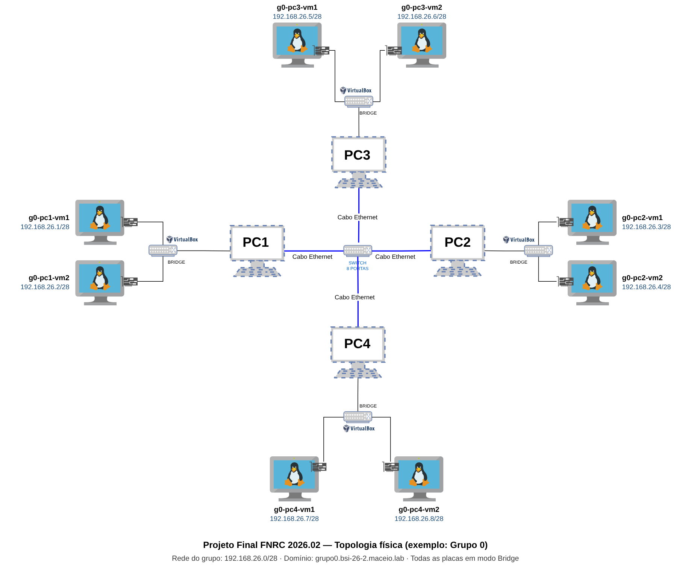
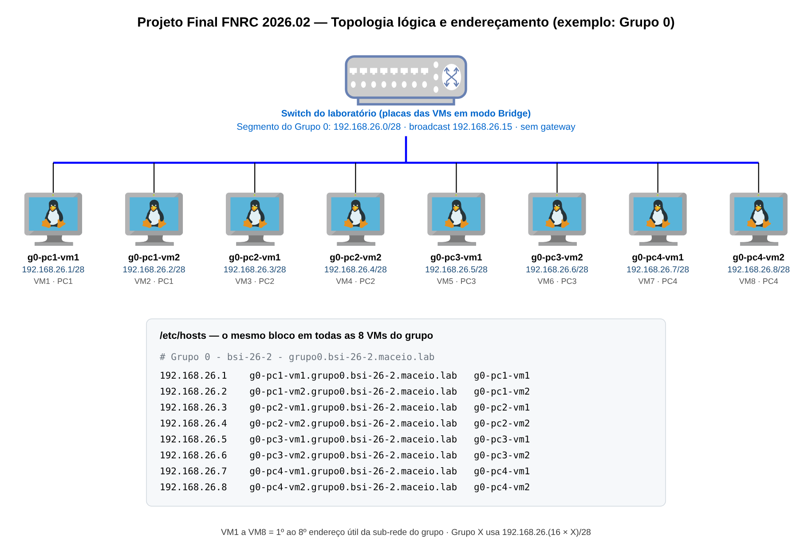

# Projeto Final — Fundamentos de Redes de Computadores (BSI 2026.02)

## Rede virtualizada com 8 VMs: endereçamento estático, nomes e testes de conectividade

### 1. Apresentação

Neste projeto, cada grupo monta uma pequena rede de computadores com **8 máquinas virtuais (VMs)** Ubuntu Server, distribuídas em **4 PCs** do laboratório (2 VMs por PC). As VMs ficam ligadas ao switch do laboratório pelo modo **Placa em Ponte (Bridge)** do VirtualBox e formam, juntas, a rede do grupo: uma sub-rede **/28** com endereços estáticos, nomes padronizados e os mesmos usuários em todas as máquinas.

O foco é aplicar os conceitos da disciplina: endereçamento IPv4 e sub-redes, máscara, broadcast, resolução de nomes e testes de conectividade. A rede do grupo **não tem gateway**: as VMs se comunicam apenas entre si, dentro da sub-rede.

A disciplina não tem aulas de Linux. Os passos necessários estão descritos neste documento, e os roteiros da pasta [material-consulta](../material-consulta/) servem para revisar ou aprender cada habilidade usada no projeto.

### 2. Objetivos

Ao final do projeto, o grupo deve ser capaz de:

1. Calcular uma sub-rede /28 (endereço de rede, broadcast e endereços úteis) e distribuir os endereços entre as VMs.
2. Instalar e configurar 8 VMs Ubuntu Server no VirtualBox, em modo Placa em Ponte.
3. Configurar IP estático com Netplan.
4. Padronizar hostnames, domínio (FQDN) e o arquivo `/etc/hosts` em todas as VMs.
5. Criar os usuários dos integrantes em todas as VMs.
6. Testar e documentar a conectividade entre as VMs com `ping` e `ssh`, usando endereços IP e nomes.

### 3. Material de consulta

| Roteiro | Conteúdo | Onde é usado no projeto |
|:--|:--|:--|
| [01 — Instalação do Ubuntu Server](../material-consulta/01-instalacao-ubuntu-server.md) | Criação da VM no VirtualBox, particionamento LVM e instalação com OpenSSH | Criação das 8 VMs |
| [02 — Usuários, grupos e permissões](../material-consulta/02-usuarios-grupos-permissoes.md) | `adduser`, `passwd`, grupos e permissões | Usuários dos integrantes (seção 9) |
| [03 — Arquivos e automação de usuários](../material-consulta/03-arquivos-e-automacao-de-usuarios.md) | `nano`, `cat`, scripts com laço `for`, `useradd`, `getent` | Criação dos usuários em lote (seção 9) |
| [04 — SSH e diagnóstico de rede](../material-consulta/04-ssh-e-diagnostico-de-rede.md) | Acesso SSH, `ip`, `route -n`, `traceroute`, `w` | Testes (seção 12) |
| [05 — Placa em Ponte e IP estático](../material-consulta/05-bridge-e-ip-estatico-netplan.md) | Modo Bridge no VirtualBox e Netplan | Rede das VMs (seção 10) |
| [06 — Nomes de host e /etc/hosts](../material-consulta/06-nomes-de-host-e-etc-hosts.md) | `hostnamectl`, FQDN, `/etc/hosts` e `getent hosts` | Nomes das VMs (seção 11) |

### 4. Topologia

**Figura 1:** Topologia física. São 4 PCs do laboratório, cada um com 2 VMs ligadas ao switch pelo modo Placa em Ponte. Os nomes e endereços são do Grupo 0 (modelo).



**Figura 2:** Topologia lógica do Grupo 0. As 8 VMs estão no mesmo segmento /28 e se encontram pelo nome graças ao `/etc/hosts`.



> **Por que Placa em Ponte?** No modo Bridge, a placa virtual da VM é ligada diretamente à placa de rede física do PC, e a VM aparece no switch do laboratório como se fosse mais um computador. É isso que permite que VMs em PCs diferentes conversem entre si. A rede do grupo (`192.168.26.x/28`) é um segmento lógico que trafega pelo mesmo switch físico do laboratório (rede `172.20.20.0/22`).

### 5. Ordem de implementação

Siga as etapas nesta ordem. As etapas 2 a 4 são feitas com a placa da VM ainda em **NAT**, que é o modo padrão do VirtualBox e dá acesso à internet para instalar pacotes. A rede do grupo não tem saída para a internet.

| Etapa | O que fazer | Seção |
|:--:|:--|:--|
| 1 | Planejar endereços, nomes e usuários do grupo | 6, 7 e 8 |
| 2 | Instalar as 2 VMs de cada PC, com OpenSSH Server | 8 |
| 3 | Atualizar a VM, instalar utilitários (`net-tools`, `traceroute`) e baixar o script de validação | 8 |
| 4 | Criar os usuários dos integrantes | 9 |
| 5 | Mudar a placa da VM para Placa em Ponte e configurar o IP estático | 10 |
| 6 | Configurar o hostname e o `/etc/hosts` | 11 |
| 7 | Testar `ping` e `ssh` e rodar o script de validação | 12 |
| 8 | Documentar tudo no repositório do grupo | 13 |

### 6. Endereçamento IP dos grupos

- A turma **bsi-26-2** usa a rede **192.168.26.0/24**, dividida em sub-redes **/28** (máscara 255.255.255.240), uma por grupo.
- O Grupo **X** usa a sub-rede `192.168.26.(16 × X)/28`. O Grupo 0 é o modelo usado nos exemplos deste documento e ocupa o 1º range; o Grupo 1 usa o 2º, o Grupo 2 o 3º, e assim por diante.
- Uma sub-rede /28 tem 16 endereços: o primeiro identifica a rede, o último é o broadcast e os 14 do meio podem ser atribuídos a máquinas [3].
- As 8 VMs do grupo usam os **8 primeiros endereços úteis**. Os demais ficam livres.

| Grupo | Rede /28 | VM1 … VM8 | Livres | Broadcast |
|:--:|:--|:--|:--|:--|
| 0 (modelo) | 192.168.26.0 | .1 – .8 | .9 – .14 | .15 |
| 1 | 192.168.26.16 | .17 – .24 | .25 – .30 | .31 |
| 2 | 192.168.26.32 | .33 – .40 | .41 – .46 | .47 |
| 3 | 192.168.26.48 | .49 – .56 | .57 – .62 | .63 |
| 4 | 192.168.26.64 | .65 – .72 | .73 – .78 | .79 |
| 5 | 192.168.26.80 | .81 – .88 | .89 – .94 | .95 |
| 6 | 192.168.26.96 | .97 – .104 | .105 – .110 | .111 |
| 7 | 192.168.26.112 | .113 – .120 | .121 – .126 | .127 |
| 8 | 192.168.26.128 | .129 – .136 | .137 – .142 | .143 |

### 7. Nomes de máquina e domínio (FQDN)

- O domínio de cada grupo segue o formato `grupoX.bsi-26-2.maceio.lab`.
- O hostname curto de cada VM indica o grupo, o PC e a VM dentro do PC, sempre em **minúsculas**: `gX-pcY-vmZ`, com PC de 1 a 4 e VM 1 ou 2.
- O FQDN é o hostname curto seguido do domínio: `gX-pcY-vmZ.grupoX.bsi-26-2.maceio.lab`.
- No VirtualBox, dê à VM o mesmo nome do hostname curto (ex.: `g0-pc1-vm1`), para facilitar a identificação no laboratório.

**Tabela de referência — Grupo 0 (modelo):**

| VM | PC | Hostname | Interface / modo | IP / máscara | FQDN |
|:--:|:--:|:--|:--|:--|:--|
| VM1 | PC1 | g0-pc1-vm1 | enp0s3 · Bridge | 192.168.26.1/28 | g0-pc1-vm1.grupo0.bsi-26-2.maceio.lab |
| VM2 | PC1 | g0-pc1-vm2 | enp0s3 · Bridge | 192.168.26.2/28 | g0-pc1-vm2.grupo0.bsi-26-2.maceio.lab |
| VM3 | PC2 | g0-pc2-vm1 | enp0s3 · Bridge | 192.168.26.3/28 | g0-pc2-vm1.grupo0.bsi-26-2.maceio.lab |
| VM4 | PC2 | g0-pc2-vm2 | enp0s3 · Bridge | 192.168.26.4/28 | g0-pc2-vm2.grupo0.bsi-26-2.maceio.lab |
| VM5 | PC3 | g0-pc3-vm1 | enp0s3 · Bridge | 192.168.26.5/28 | g0-pc3-vm1.grupo0.bsi-26-2.maceio.lab |
| VM6 | PC3 | g0-pc3-vm2 | enp0s3 · Bridge | 192.168.26.6/28 | g0-pc3-vm2.grupo0.bsi-26-2.maceio.lab |
| VM7 | PC4 | g0-pc4-vm1 | enp0s3 · Bridge | 192.168.26.7/28 | g0-pc4-vm1.grupo0.bsi-26-2.maceio.lab |
| VM8 | PC4 | g0-pc4-vm2 | enp0s3 · Bridge | 192.168.26.8/28 | g0-pc4-vm2.grupo0.bsi-26-2.maceio.lab |

### 8. Criação das VMs

Siga o [Roteiro 01](../material-consulta/01-instalacao-ubuntu-server.md) e os [vídeos de apoio](../README.md#-vídeos-de-apoio) sobre VMs no VirtualBox, com estes ajustes:

- **Sistema:** Ubuntu Server 22.04 LTS ([ubuntu-22.04.5-live-server-amd64.iso](https://releases.ubuntu.com/jammy/ubuntu-22.04.5-live-server-amd64.iso)), mais leve para rodar com pouca memória.
- **Hardware de cada VM:** 1 CPU e disco de 32 GB (VDI, alocação dinâmica). Crie a VM com **1,5 GB (1536 MB) de RAM** para instalar o sistema e, depois da instalação e da primeira atualização, reduza para **512 MB** (Roteiro 01, seção 5.1). Com 512 MB, as 2 VMs de cada PC rodam juntas sem pesar no computador.
- **Pastas no PC (Windows):** ISO em `C:\2026.2\BSI\VM\original` e VMs em `C:\2026.2\BSI\VM\<NomeDoAluno>`.
- **Nome da VM no VirtualBox** e **Your server's name** no instalador: o hostname curto da VM (ex.: `g0-pc1-vm1`).
- **Usuário administrador:** `administrador`, com a senha padrão do laboratório.
- Marque **Install OpenSSH Server** durante a instalação.
- Mantenha a placa de rede em **NAT** durante a instalação e use esse acesso à internet para atualizar a VM e instalar os utilitários de rede:

```bash
sudo apt update
sudo apt install -y net-tools traceroute
```

Ainda em NAT, baixe também o script de validação usado no final (seção 12):

```bash
wget https://raw.githubusercontent.com/alaelson/fnrc_bsi_2026.2/main/projeto-final/validacao-pf.sh
```

> **Clonou uma VM?** Se o grupo criar a segunda VM de um PC clonando a primeira, escolha a opção de **gerar novos endereços MAC** para todas as placas. Duas VMs com o mesmo MAC no mesmo switch não conseguem se comunicar corretamente. Depois de clonar, altere também o hostname (seção 11).

### 9. Usuários

- Cada VM tem o usuário **`administrador`** e **um usuário para cada integrante** do grupo.
- O nome de usuário segue o formato `nome.sobrenome`, em minúsculas, sem acentos e sem espaços (ex.: `marlos.silva`).
- O conjunto de usuários é **o mesmo nas 8 VMs**.
- Cada usuário tem diretório em `/home/<usuário>` e shell `/bin/bash`.

Exemplo para o Grupo 0, executado em cada VM (ver [Roteiro 03](../material-consulta/03-arquivos-e-automacao-de-usuarios.md)):

```bash
for u in marlos.silva victor.lima nicolas.costa yury.araujo; do
  sudo useradd -m -s /bin/bash "$u"
  sudo passwd "$u"
done

# Verificação
getent passwd marlos.silva victor.lima nicolas.costa yury.araujo
ls -l /home
```

### 10. Placa em Ponte e IP estático (Netplan)

**No VirtualBox** (ver [Roteiro 05](../material-consulta/05-bridge-e-ip-estatico-netplan.md), seção 2): com a VM desligada, em **Configurações → Rede → Adaptador 1**, altere **Conectado a** para **Placa em Ponte** e selecione a placa de rede física do PC.

**Na VM**, veja qual arquivo existe em `/etc/netplan/` e edite-o com `sudo nano` [1, 2]:

```bash
ls /etc/netplan/
sudo nano /etc/netplan/00-installer-config.yaml   # use o nome do arquivo listado
```

Modelo para a VM1 do Grupo 0 (`g0-pc1-vm1`). Troque apenas o endereço em `addresses` em cada VM:

```yaml
network:
  version: 2
  renderer: networkd
  ethernets:
    enp0s3:
      dhcp4: false
      addresses:
        - 192.168.26.1/28
```

- A rede do grupo **não tem gateway**: por isso o arquivo não tem `routes` nem `nameservers`. Sem rota padrão, a VM fala apenas com as máquinas da própria sub-rede.
- Use espaços (nunca `Tab`) e mantenha a indentação de 2 espaços por nível.

Aplique e confira:

```bash
sudo netplan apply
ip -4 addr show enp0s3      # deve mostrar 192.168.26.1/28
ip route                    # deve mostrar 192.168.26.0/28 dev enp0s3
```

### 11. Hostname e /etc/hosts

Detalhes no [Roteiro 06](../material-consulta/06-nomes-de-host-e-etc-hosts.md).

**Hostname.** Configure em cada VM o FQDN completo:

```bash
sudo hostnamectl set-hostname g0-pc1-vm1.grupo0.bsi-26-2.maceio.lab
hostname
cat /etc/hostname
```

**/etc/hosts.** Como a rede do grupo não tem servidor DNS, a resolução de nomes é feita localmente. O `/etc/hosts` de **todas as 8 VMs** deve conter uma linha para cada máquina do grupo, no formato `IP  FQDN  apelido` [4]. Exemplo do Grupo 0:

```
# Grupo 0 - bsi-26-2 - grupo0.bsi-26-2.maceio.lab
192.168.26.1    g0-pc1-vm1.grupo0.bsi-26-2.maceio.lab    g0-pc1-vm1
192.168.26.2    g0-pc1-vm2.grupo0.bsi-26-2.maceio.lab    g0-pc1-vm2
192.168.26.3    g0-pc2-vm1.grupo0.bsi-26-2.maceio.lab    g0-pc2-vm1
192.168.26.4    g0-pc2-vm2.grupo0.bsi-26-2.maceio.lab    g0-pc2-vm2
192.168.26.5    g0-pc3-vm1.grupo0.bsi-26-2.maceio.lab    g0-pc3-vm1
192.168.26.6    g0-pc3-vm2.grupo0.bsi-26-2.maceio.lab    g0-pc3-vm2
192.168.26.7    g0-pc4-vm1.grupo0.bsi-26-2.maceio.lab    g0-pc4-vm1
192.168.26.8    g0-pc4-vm2.grupo0.bsi-26-2.maceio.lab    g0-pc4-vm2
```

A linha `127.0.1.1`, criada na instalação, deve apontar para o nome da própria VM:

```
127.0.1.1    g0-pc1-vm1.grupo0.bsi-26-2.maceio.lab    g0-pc1-vm1
```

### 12. Testes e validação

Registre no repositório do grupo os comandos e as saídas de:

1. `ping` de cada VM para as outras 7, usando o **IP**, o **apelido** e o **FQDN**:
   ```bash
   ping -c 3 192.168.26.3
   ping -c 3 g0-pc2-vm1
   ping -c 3 g0-pc2-vm1.grupo0.bsi-26-2.maceio.lab
   ```
2. Acesso `ssh` entre VMs de **PCs diferentes**, com o usuário de cada integrante (ver [Roteiro 04](../material-consulta/04-ssh-e-diagnostico-de-rede.md)):
   ```bash
   ssh marlos.silva@g0-pc3-vm2
   hostname     # já dentro da sessão remota
   w            # mostra a sessão aberta e o IP de origem
   exit
   ```
3. Resolução de nomes: `getent hosts g0-pc4-vm2`.
4. **Script de validação:** em cada VM, use o [validacao-pf.sh](validacao-pf.sh) baixado na seção 8. Se esqueceu de baixá-lo, copie-o de outra VM do grupo com `scp administrador@g0-pc1-vm1:validacao-pf.sh .`. Edite a seção *CONFIGURAÇÃO DO GRUPO* (número do grupo e usuários) e execute:
   ```bash
   sudo bash validacao-pf.sh | tee validacao-$(hostname -s).txt
   ```
   O script confere o IP e a máscara, o Netplan, o hostname, o `/etc/hosts`, a resolução de nomes, os usuários, o serviço SSH e a conectividade (`ping` e porta 22) com as outras 7 VMs. O resultado esperado é **nenhum item com FALHOU**. Os 8 arquivos `validacao-<hostname>.txt` vão para a pasta `validacao/` do repositório do grupo.

### 13. Repositório do grupo

Cada grupo cria **um repositório público** no GitHub chamado:

```text
fnrc-2026.2-bsi-pf-grupoX
```

com `X` igual ao número do grupo (ex.: `fnrc-2026.2-bsi-pf-grupo3`).

- Um integrante cria o repositório e adiciona os demais como colaboradores (**Settings → Collaborators**). Adicione também o professor (`alaelson`).
- Cada integrante deve enviar (commit) a documentação e as evidências das VMs que configurou, para que o histórico mostre a participação de todos.
- Organize o repositório desta forma:

```text
fnrc-2026.2-bsi-pf-grupoX/
├── README.md                 # Identificação do grupo, integrantes e links para os arquivos abaixo
├── 01-planejamento.md        # Endereçamento, nomes, usuários e topologia do grupo (Etapa 1)
├── 02-criacao-das-vms.md     # Hardware de cada VM e instalação do Ubuntu Server
├── 03-usuarios.md            # Criação dos usuários dos integrantes
├── 04-rede-netplan.md        # Placa em Ponte e IP estático de cada VM
├── 05-hostname-e-hosts.md    # Hostname e /etc/hosts
├── 06-testes.md              # Testes de ping, ssh e resolução de nomes
├── configs/
│   ├── hosts                 # Bloco do /etc/hosts usado nas 8 VMs
│   └── netplan/
│       ├── gX-pc1-vm1.yaml   # Arquivo Netplan de cada VM
│       └── ... (uma por VM)
├── validacao/
│   ├── validacao-gX-pc1-vm1.txt
│   └── ... (saída do script em cada VM)
└── imagens/                  # Capturas de tela de evidência
    ├── topologia-grupoX.png
    ├── pc1_virtualbox_bridge.png
    ├── g0-pc1-vm1_ip_addr.png
    └── ... (demais capturas)
```

**Regras:**

- Os arquivos `.md` ficam na raiz, numerados na ordem da implementação.
- Cada arquivo deve trazer o comando executado, a saída obtida e a captura de tela correspondente.
- As capturas de tela ficam na pasta `imagens/`, com nomes em minúsculas, sem espaços nem acentos, indicando a VM ou o PC (ex.: `g0-pc2-vm1_ping.png`).
- Referencie as imagens com caminho relativo: ``.
- O `01-planejamento.md` traz a tabela da seção 7 preenchida com os dados do grupo, o bloco do `/etc/hosts`, a lista de usuários e a topologia do grupo (adaptada das Figuras 1 e 2).

---

## Prazos e entregas

### Etapa 1 — Planejamento (data a definir)

a) Criar o repositório do grupo com a estrutura da seção 13 e adicionar o professor como colaborador.

b) Publicar o `01-planejamento.md`, com as tabelas de endereçamento, nomes e usuários e a topologia do grupo.

### Etapa 2 — Implementação e apresentação final (data a definir)

a) Rede do grupo funcionando no laboratório, com as 8 VMs configuradas.

b) Repositório completo: documentação de todas as etapas, arquivos de configuração, saídas do script de validação e evidências dos testes.

c) Apresentação do grupo, com demonstração de `ping` e `ssh` entre VMs de PCs diferentes.

---

## Referências

[1] CANONICAL. **Configuring networks**. Ubuntu Server documentation. Disponível em: <https://ubuntu.com/server/docs/configuring-networks>.

[2] NETPLAN. **Netplan reference** (YAML configuration). Disponível em: <https://netplan.readthedocs.io/en/latest/reference/>.

[3] KUROSE, James F.; ROSS, Keith W. **Redes de Computadores e a Internet**. 8. ed. Pearson, 2022.

[4] LINUX MAN-PAGES PROJECT. **hosts(5) — static table lookup for hostnames**. Disponível em: <https://man7.org/linux/man-pages/man5/hosts.5.html>.
